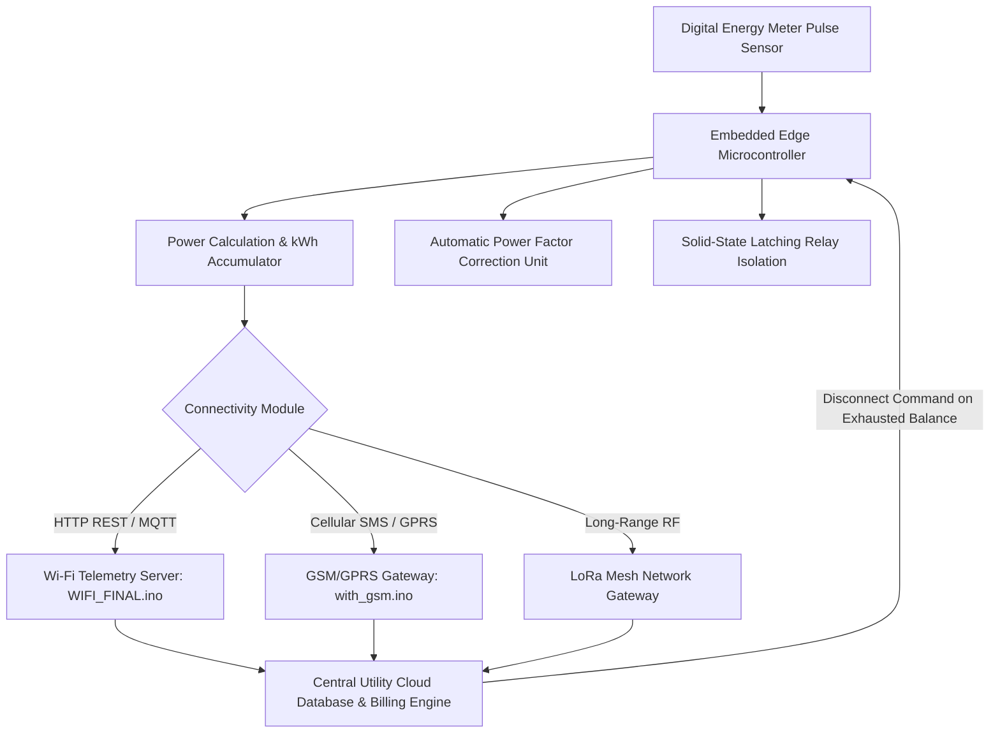

# ⚡ Automated Electricity Metering System (AEMS) — Smart Grid IoT Edge

[](https://github.com/Aniket-Gund/Automated-Electricity-Metering-System/stargazers)
[](https://arduino.cc)
[](https://espressif.com)
[](LICENSE)

An advanced IoT-driven **Automated Electricity Metering System (AEMS)** engineered for smart power distribution grids. Incorporates bidirectional wireless telemetry (Wi-Fi, GSM, and LoRa), prepaid metering balance updates, automatic power factor correction, and solid-state latching relay load disconnections.

---

## 🌟 Key System Capabilities

- **📊 High-Precision Energy Consumption Monitoring**: Computes real-time kilowatt-hour (kWh) power draw from optical/digital meter pulse outputs.
- **💳 Smart Prepaid Metering & Recharge**: Embedded server endpoints allowing remote account credit recharges and automatic balance deduction.
- **🔌 Remote Cut-off & Reconnection**: Solid-state latching relay controls to remotely isolate non-compliant or zero-balance loads.
- **⚡ Automatic Power Factor Correction (APFC)**: Dynamically adjusts reactive power via capacitor banks to minimize grid transmission losses.
- **🛡️ Tamper & Malfunction Edge Detection**: Implements algorithms to identify phase imbalances, meter bypass tampering, and anomalous loads.

---

## 🏗️ Telemetry & Network Architecture



---

## 📂 Repository Contents

```
Automated-Electricity-Metering-System/
│
├── Firmware Sources:
│   ├── WIFI_FINAL.ino              # Wi-Fi web server & telemetry controller
│   ├── with_gsm.ino                # Cellular SIM800 GSM SMS communication
│   ├── GPRS_SERVER_Transfer.ino    # GPRS direct TCP/IP socket data push
│   ├── with_keypad.ino             # Local keypad authentication & recharge
│   ├── simulation_with_all.ino     # Comprehensive simulation test routine
│   └── all_componentlcd_29.ino     # LCD multi-parameter display manager
│
├── Engineering Schematics & PCB:
│   ├── PCB_Final_BOTH.pdf          # Double-sided PCB layout masks
│   ├── PCB_Final_BOTH_With_Silk.pdf# Silkscreen component placement overlay
│   └── Power Requirements And Calculations.pdf
│
└── Research & Documentation:
    ├── AEMS_Report_Final.pdf       # Comprehensive thesis report
    ├── Final Budget.pdf            # Bill of Materials (BOM) & costing
    └── AMS Evaluation-1.pptx       # Technical presentation
```

---

## 🚀 Getting Started

1. **Hardware Assembly**:
   - Refer to `PCB_Final_BOTH_With_Silk.pdf` for PCB soldering and component layout.
   - Connect solid-state latching relay to primary AC power line.
2. **Firmware Selection**:
   - For Wi-Fi telemetry: Open `WIFI_FINAL.ino` in Arduino IDE and configure your SSID and server credentials.
   - For GSM/GPRS: Open `with_gsm.ino` and set utility APN and central SMS receiver number.
3. **Compile & Upload**: Flash the corresponding firmware to your microcontroller board.

---

## 👨‍💻 Author

**Aniket Gund**
- GitHub: [@Aniket-Gund](https://github.com/Aniket-Gund)
- LinkedIn: [Aniket Gund](https://www.linkedin.com/in/aniket-gund/)

---

## 📄 License

Distributed under the [MIT License](LICENSE).
